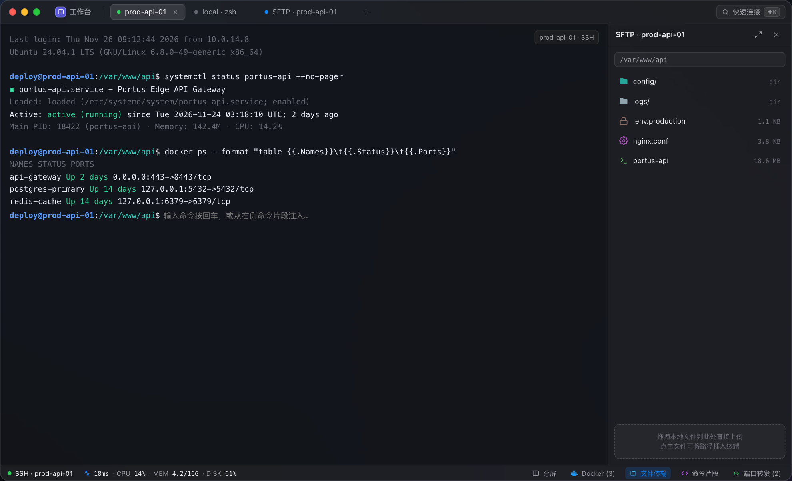
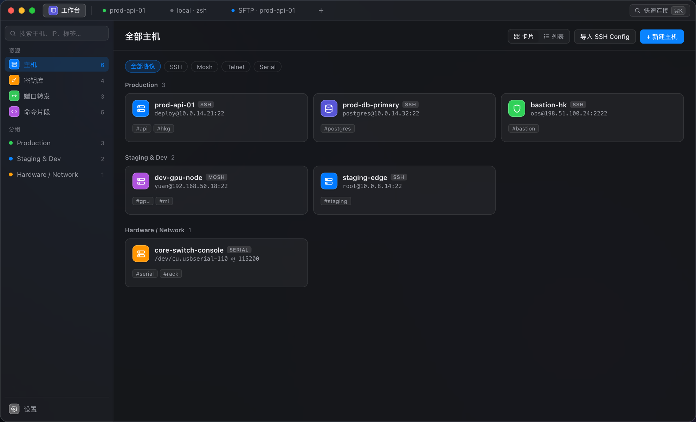
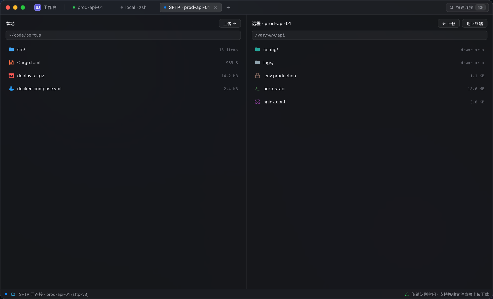

<p align="center">
  
</p>

<h1 align="center">Portus</h1>

<p align="center">原生 macOS 终端、SSH 和 SFTP 客户端，使用 Rust 和 GPUI 构建。</p>

## 产品截图

截图来自 [Portus 交互原型](prototype/index.html)，使用示例数据。



| 主机工作台 | 双栏 SFTP |
| --- | --- |
| [](assets/screenshots/hosts.png) | [](assets/screenshots/sftp.png) |

## 功能

- **终端工作区**支持本地 PTY、多标签、分屏、终端搜索和中文输入。
- **SSH 主机管理**支持快速连接、导入 `~/.ssh/config`、复用密钥或密码，以及通过多级跳板连接。也支持 Telnet、串口和 Mosh。使用 Mosh 时，本机需要有可执行的 `mosh` 命令。
- **SFTP 文件传输**支持在终端侧边栏中浏览远程文件，也可以在双栏视图中上传和下载。
- **端口转发和命令片段**支持本地、远程和 SOCKS 动态转发，并可将常用命令从片段库发送到当前终端。
- **本地 MCP 服务**支持按主机授权、按工具启停，以及在桌面端审批请求、查看会话审计和回放。

## 从源码运行

当前构建已在 Apple Silicon Mac 上验证。需要 Rust 1.98 或更新版本，以及带 Metal 工具链的 Xcode。

```sh
git clone git@github.com:tyuan511/portus.git
cd portus
cargo run --locked
```

> [!TIP]
> 如果构建时提示缺少 Metal 工具链，可运行 `xcodebuild -downloadComponent metalToolchain`。参见 [Apple 的 Xcode 组件安装说明](https://developer.apple.com/documentation/Xcode/downloading-and-installing-additional-xcode-components)。

在应用中按 `⌘T` 新建本地终端，或按 `⌘K` 打开快速连接，输入 SSH 目标，例如 `user@example.com:22`。批量添加主机可以在 **文件 → SSH 主机** 中选择 **导入 SSH Config**。

| 快捷键 | 操作 |
| --- | --- |
| `⌘T` | 新建本地终端 |
| `⌘K` | 打开快速连接 |
| `⌘D` | 分屏 |
| `⌘F` | 搜索终端内容 |
| `⌘⇧E` | 显示或隐藏文件抽屉 |
| `⌘,` | 打开设置 |

## MCP 接入

在 **设置 → MCP 服务** 中选择传输方式和客户端，再点 **复制配置**。

- **Streamable HTTP** 由桌面应用提供，默认地址为 `http://127.0.0.1:7331/mcp`，仅监听本机回环地址。需要人工审批时，在桌面应用中处理。
- **stdio** 由客户端以 `--mcp-stdio` 参数启动 Portus。使用源码构建时，配置中的启动命令填写二进制的绝对路径。该模式会拒绝需要人工审批的请求。

主机的默认授权为 **禁止**。可在 **主机授权与策略** 中查看或调整各主机的权限。

## 设置和备份

macOS 上的设置保存在 `~/Library/Application Support/Portus/settings.json`。**设置 → 安全与备份** 可导出或导入加密备份，覆盖主机、密钥库、端口转发和命令片段。新备份使用 `.portus-vault` 扩展名。

从 Bulwark 升级时，如果 Portus 配置目录还不存在，首次启动会把旧设置和本地凭据密钥复制到新目录，旧目录可用作备份。已有的 `.bulwark-vault` 文件仍可导入。

## 开发与验证

```sh
cargo build --locked
cargo test --locked
```

桌面入口在 [`src/main.rs`](src/main.rs)。[`src/workspace.rs`](src/workspace.rs) 管理工作区，[`src/terminal.rs`](src/terminal.rs) 和 [`src/ssh.rs`](src/ssh.rs) 分别处理终端与内置 SSH 会话。终端组件及网格实现位于 [`vendor/`](vendor/)。

可在浏览器中打开 [交互原型](prototype/index.html) 查看界面和操作流程。终端输出性能数据及复测方法见 [PTY 网格基准](benchmarks/pty-grid.md)。

## 版本发布

将 `Cargo.toml` 和 `Cargo.lock` 中的版本同步后，在包含发布工作流的提交上创建并推送 `vX.Y.Z` 标签。标签必须与 Cargo 包版本一致。

```sh
git tag v0.1.0
git push origin v0.1.0
```

[发布工作流](.github/workflows/release.yml) 会测试并构建 macOS arm64，在 [GitHub Releases](https://github.com/tyuan511/portus/releases) 上传 `Portus-v0.1.0-macos-arm64.dmg`，Release 正文留空。打开 DMG 后，将 `Portus.app` 拖入 Applications。应用包使用 ad-hoc 签名，尚未进行 Apple 公证。
